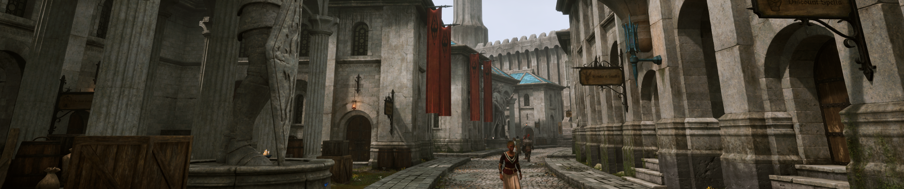

# 
 RACES

[ <a href="https://github.com/sasquatch678/A-Painted-World---Remastered/blob/main/Gameplay/Races.md#argonian">Argonian</a> |
  <a href="https://github.com/sasquatch678/A-Painted-World---Remastered/blob/main/Gameplay/Races.md#breton">Breton</a> |
  <a href="https://github.com/sasquatch678/A-Painted-World---Remastered/blob/main/Gameplay/Races.md#dark-elf">Dark Elf</a> |
  <a href="https://github.com/sasquatch678/A-Painted-World---Remastered/blob/main/Gameplay/Races.md#high-elf">High Elf</a> |
  <a href="https://github.com/sasquatch678/A-Painted-World---Remastered/blob/main/Gameplay/Races.md#imperial">Imperial</a> |
  <a href="https://github.com/sasquatch678/A-Painted-World---Remastered/blob/main/Gameplay/Races.md#khajiit">Khajiit</a> |
    <a href="https://github.com/sasquatch678/A-Painted-World---Remastered/blob/main/Gameplay/Races.md#nord">Nord</a> |
    <a href="https://github.com/sasquatch678/A-Painted-World---Remastered/blob/main/Gameplay/Races.md#orc">Orc</a> |
    <a href="https://github.com/sasquatch678/A-Painted-World---Remastered/blob/main/Gameplay/Races.md#redguard">Redguard</a> |
    <a href="https://github.com/sasquatch678/A-Painted-World---Remastered/blob/main/Gameplay/Races.md#wood-elf">Wood Elf</a> ]
  
All races now have one passive and one greater power which can be augmented by the rune stones you find out in the world. This makes the runestones actually useful and worth visiting while also overhauling the races to make them more balanced and unique. You can swap between each augmentation once per day by visiting one of the associated rune stones. In vanilla there are three types of runestones; Hestra, Reman, and Sidri-Ashak.
- Hestra stones are believed to be named for the late First Era Empress Hestra. These augmentations are focused around magic and offense.
- Reman stones are almost certainly named for Reman Cyrodiil, the First Era emperor. These augmentations are focused around combat and defense.
- Sidri-Ashak stones are thought to be named for an obscure Akaviri potentate, Sidri-Ashak. These augmentations are focused around stealth, utility, and cooldown manipulation.

***
### Argonian
*Passive* - Marsh Skin - Poison Resistance 75% + Waterbreathing.  
*Power* - Caustic Spit - Once per day paralyze a target for 10 seconds.

- Hestra - Caustic Spit also causes the target to become 50% weaker to Magic and Poisons for 120 seconds.
- Reman - Marsh Skin now also Restores 1 point of Health per second. This effect is doubled while swimming.
- Sidri-Ashak - Caustic Spit is now a lesser power and also opens up to Hard level locks, but only Paralyzes for 2 seconds and costs 75 Fatigue.
***
### Breton

*Passive* - Aldmeri Heritage - Magic Resistance 15% and Fortify Magicka 50 points.  
*Power* - Dragon Skin - Once per day Shield yourself 50 points for 120 seconds.

- Hestra - Dragon Skin now also gives 50% Spell Absorption for 120 seconds.
- Reman - Dragon Skin now also Reflects 50% of physical damage taken.
- Sidri-Ashak - Dragon Skin now also gives 50% Chameleon for 120 seconds.
***
### Dark Elf

*Passive* - Balanced Scales - Gain 50% Fire Resistance. When below 50% of your base Magicka, Fortify 25 points of Strength. When below 50% Fatigue, Fortify 25 points of Intelligence.  
*Power* - Ancestor Guardian - Once per day Summon an Ancestor Guardian to protect you for 120s. (Ancestor Guardian now scales 1:1 with the player's level, has Fire Immunity in addition to it's existing immunities, and casts a leveled fire spell instead of just snowball).

- Hestra - The effects of Balanced Scales are doubled.
- Reman - Ancestor Guardian now also gives you 50 points of Fire Shield for 120 seconds.
- Sidri-Ashak - Ancestor Guardian is now a lesser power and Soul Traps a target, but costs 75 magicka.
***
### High Elf

*Passive* - Naturalborn Talent - Fortify Magicka 75 points, Weakness to Magic 15%  
*Power* - Highborn - Restore 10 magicka/s for 120 seconds.

- Hestra - Naturalborn Talent now Fortifies Magicka by 125 points.
- Reman - Highborn now also gives 50 points of Spell Reflect for 120 seconds.
- Sidri-Ashak - Highborn now also Dispels 250 points on self and on touch.
***
### Imperial

*Passive* - Bulwark of Cyrodiil - Gain 15 points of Shield.  
*Power* - Voice of the Emperor - Silence all enemies around you and Calm a target for 120 seconds.

- Hestra - Voice of the Emperor now Commands a target instead of Calms.
- Reman - Voice of the Emperor no longer Silences or Calms. Instead it Rallies all nearby allies and Fortifies their Endurance by 100 points. These effects are halved on yourself.
- Sidri-Ashak - Voice of the Emperor becomes a Lesser Power, but no longer causes Silence, lasts 30 seconds, and costs 75 magicka.
***
### Khajiit

*Passive* - Feline Grace - Gain 25 points of Speed and 50 points of Detect Life while sneaking.  
*Power* - Prowl - Gain Invisibility for 120 seconds.

- Hestra - You now gain 50 points of Speed and 100 points of Detect Life while sneaking.
- Reman - Prowl now also Fortifies your Strength and Agility by 50 points for 120 seconds.
- Sidri-Ashak - Prowl is now a lesser power, but lasts 10 seconds and costs 75 Fatigue.
***
### Nord

*Passive* - Blood of the North - Resist Paralysis, Frost, and Shock 30%.  
*Power* - Battle Cry - Demoralize for 120 seconds and Absorb 100 points of Fatigue of all targets in a 50 yard radius.

- Hestra - Battle Cry also weakens targets, causing them to take 50% additional damage.
- Reman - Battle Cry now also grants you 25 points of Shield and 5 points of Restore Health for the duration.
- Sidri-Ashak - Battle Cry is now a lesser power, but only lasts 10 seconds, no longer Absorbs Fatigue, and costs 75 Fatigue.
***
### Orc

*Passive* - Malacath's Scorn - When you are below 33% base Health, Fortify Strength 25 points and Restore Health 1/s.  
*Power* - Berserk - Fortify Strength 50 points and Resist Normal Weapons 50% for 120 seconds.

- Hestra - Berserk now also Fortifies Blade, Blunt, and Hand to Hand by 50 points for 120 seconds.
- Reman - Berserk now also Fortifies Endurance 50 points for 120 seconds.
- Sidri-Ashak - Malacath's Scorn can now be triggered when below 66% base Health.
***
### Redguard

*Passive* - Nomadic Heritage - Fortify Fatigue 100 pts. While above 75% Fatigue, Fortify Speed and Athletics 15 points.  
*Power* - Adrenaline Rush - Restore 10 points of Fatigue/s for 120 seconds.

- Hestra - Adrenaline Rush also Fortifies 25 points of Blade, Blunt, and Willpower for the duration.
- Reman - Nomadic Heritage now Fortifies Fatigue by 150, and incoming damage is reduced by 10% when above 75% Fatigue.
- Sidri-Ashak - Adrenaline Rush also Fortifies Speed 50 pts and becomes a lesser power, but only lasts 15s and costs 75 magicka.
***
### Wood Elf

*Passive* - Roots of Valen - Restore an additional 1 Fatigue per second and gain 75% Disease Resistance. While outdoors you restore 2 additional points of Fatigue.  
*Power* - Beast Tongue - Command a Creature to fight under your control for 360 seconds.

- Hestra - Beast Tongue now lasts 600s, gives 50% Magic Resistance to the creature for the duration, and 25% Magic Resistance to you for 120s.
- Reman - Beast Tongue now lasts 600s, Restores 2 points of Health and Fatigue/s to the creature for the duration, and also Restores 2 points of Health and Fatigue/s to you for 120 seconds.
- Sidri-Ashak - Beast Tongue now lasts 1200s and is a lesser power.
***
